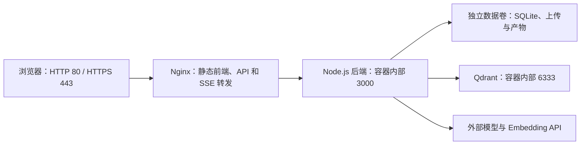

# Docker 与 Nginx 部署：从本机预览到公开试用

这套配置面向当前的免注册公开试用：单台 Linux 服务器、一个后端进程、SQLite 和 Qdrant。先通过公网 IP + HTTP 短期试用，之后有域名再切换 HTTPS；不需要 IP 证书。

HTTP 下的访客 Cookie 和对话内容会明文传输。公开 HTTP 试用只使用示例内容；需要长期使用或输入私人内容时，先完成域名 HTTPS。



## 配置文件分别做什么

| 文件 | 作用 |
| --- | --- |
| `Dockerfile` | 分阶段构建后端和前端；运行镜像使用 Node.js 22 与 Nginx，包含 Linux 原生 SQLite 依赖 |
| `.dockerignore` | 本地密钥、数据库、证书、依赖和生成文件不进入构建上下文 |
| `compose.production.yml` | 启动独立试用环境；只有 Nginx 发布端口，后端和 Qdrant 不发布端口 |
| `compose.https.yml` | 有域名和证书后叠加使用，开启 Secure Cookie 并将 HTTP 跳转至 HTTPS |
| `deploy/.env.example` | 部署变量模板，模型密钥只在运行时交给后端 |
| `deploy/demo.sh` | 缩短 Compose 命令；默认 HTTP，加 `--https` 使用 HTTPS 配置 |
| `deploy/systemd/` | 域名证书自动续期和 Nginx 重载，每 12 小时检查一次 |

宿主机只需要 Docker Engine 和 Docker Compose 插件。构建、TypeScript、pnpm 和前端打包都在镜像内完成。Dockerfile 固定 pnpm 10.11.0，并使用锁文件安装依赖。

后端镜像包含 Playwright Chromium 和中日韩字体，用于试用模式的 PDF 和 PPT 渲染。Word 由后端直接生成。不要把这份 Compose 改成普通本地模式后直接暴露到公网。

## 第一步：确认服务器环境

在你已经登录的服务器终端执行：

```bash
cat /etc/os-release
uname -m
docker --version
docker compose version
```

记录 Linux 发行版、CPU 架构以及 Docker 是否已安装。Docker 安装步骤按实际系统选择官方说明：[Ubuntu](https://docs.docker.com/engine/install/ubuntu/)、[Debian](https://docs.docker.com/engine/install/debian/)。其他发行版不要照抄 Ubuntu 安装命令。

后续命令假设当前用户可以运行 Docker；如服务器要求使用 `sudo`，先进入有 Docker 权限的终端。不要开放 Docker 远程控制端口。

## 第二步：把代码放到服务器

推荐目录 `/opt/evident-loop`。服务器拉取包含这些部署文件的仓库版本，或者从本机上传工作区。上传前先在服务器创建目录，并确保登录用户有写入权限。

本机上传示例（替换登录用户和公网 IP；在本机项目根目录执行）：

```bash
rsync -az \
  --include='.env.example' --exclude='.env*' \
  --exclude='.git' --exclude='node_modules' --exclude='dist' \
  --exclude='backend/data' --exclude='backups' \
  --exclude='.agents' --exclude='.codex' --exclude='.aws' \
  --exclude='*.sqlite*' --exclude='*.pem' --exclude='*.key' --exclude='*.log' \
  ./ 用户名@服务器公网IP:/opt/evident-loop/
```

不会把本地模型密钥或研究数据库带到服务器。后续需要的密钥在服务器端单独填写，不发到聊天里。

## 第三步：设置 IP + HTTP 试用参数

在服务器项目根目录执行：

```bash
cp deploy/.env.example deploy/.env
chmod 600 deploy/.env
```

只在第一次创建文件时复制。后续更新代码保留已有 `deploy/.env`，避免覆盖密钥与配置。编辑 `deploy/.env`，先设置以下值（替换公网 IP）：

```dotenv
SITE_HOST=你的服务器公网IPv4
APP_ORIGIN=http://你的服务器公网IPv4
HTTP_BIND=0.0.0.0
HTTP_PORT=80
APP_VERSION=trial-v1
LLM_PROVIDER=deepseek
DEEPSEEK_API_KEY=在服务器填写真实密钥
```

`SITE_HOST` 只写主机名或 IPv4，不包含 `http://`、路径或端口。模板中的 `localhost` 用于本机预览。不要把上面的中文提示原样保存为配置值。

如果使用 MiniMax，则设置 `LLM_PROVIDER=minimax` 和 `MINIMAX_API_KEY`。第一次可先只验证对话，Embedding 密钥留空；准备示例知识检索时再填写。

模板保留每访客每天 10 次、每 IP 每天 10 次、全站每天 100 次，以及全站并发 3 个任务。共用同一出口 IP 的访客也共用 IP 额度。

试用模式、持久化路径、内部 Qdrant 地址、信任代理和 HTTP Cookie 模式由 Compose 明确设置。Nginx 固定内部 IP，后端只信任该地址；Nginx 会覆盖用户提供的转发头，避免伪造 IP 绕过额度。

若 `172.30.240.0/24` 与服务器已有 Docker/VPN 网络冲突，同时调整 `DEMO_NETWORK_SUBNET` 和 `NGINX_INTERNAL_IP`；代理地址必须在该子网内。

## 第四步：构建并启动

```bash
./deploy/demo.sh config --quiet
./deploy/demo.sh build
./deploy/demo.sh up -d --wait
./deploy/demo.sh ps
```

`config --quiet` 只校验配置；不要把完整的 `docker compose config` 输出发到聊天里，因为它可能展开密钥。第一次构建要下载基础镜像和依赖，会比之后更新慢。

`ps` 中 backend 和 nginx 应当显示 healthy，Qdrant 应当处于 running。后端健康检查表示应用已启动，不表示模型密钥或知识检索已经可用。

确认服务器的云安全组和防火墙允许 TCP 80；SSH 端口保留你现有的访问方式。不要开放 3000、6333 或 6334。然后在浏览器打开 `http://你的公网IP`。

如果已经有其他站点占用 80，先确认现有服务，再决定接入方式；不要直接停止未知服务。短期也可改用 `HTTP_PORT=8080`，同时将 `APP_ORIGIN` 改成 `http://公网IP:8080` 并放行对应端口。

## 第五步：逐项验收

```bash
curl --fail http://你的公网IP/api/health
./deploy/demo.sh exec -T nginx nginx -t
./deploy/demo.sh logs --tail=80 backend nginx
```

浏览器先发送一句简单问题，验证真实模型密钥和服务器出网；然后用普通窗口与隐私窗口分别建立会话，确认列表互不可见。分别检查：

- `/api/demo` 返回当前访客的剩余额度，页面显示 10 次默认额度；每次获准启动研究后递减。
- 对方的会话或运行 ID 无法读取、修改、取消或订阅；管理接口返回 403。
- 页面研究进度通过 SSE 持续到达。Nginx 已关闭该路径的响应缓冲与压缩。
- 在会话里分别生成 Word、PDF 和 PPT，确认草稿可编辑，生成后可预览并下载。隐私窗口访问同一文件地址应返回 404。
- `./deploy/demo.sh restart backend` 后，历史和已用额度仍保留；重启会中断正在运行的研究，待空闲再操作。
- `./deploy/demo.sh ps` 中没有后端和 Qdrant 的宿主机端口映射。

这套生产配置不会上传已有本地研究数据。实例内置自动清理：每 24 小时扫描一次闲置满 24 小时的内容，通常保留 24～48 小时。

在装有 Node.js、Docker Compose 和 OpenSSL 的测试环境运行 `node deploy/tests/smoke.mjs`，可用模拟模型和临时证书检查容器中的文稿生成、下载、访客隔离和 HTTPS；真实模型验收仍在目标服务器单独进行。

## 可选：启用公共示例知识检索

先在服务器 `deploy/.env` 填写 `EMBEDDING_API_KEY`，并让后端加载新配置：

```bash
./deploy/demo.sh up -d --wait backend
./deploy/demo.sh exec -T backend node seed-demo.mjs
./deploy/demo.sh exec -T backend node seed-demo.mjs --index
```

第一条导入命令只写入仓库中的公开试用说明；重复执行不会重复导入，也不会覆盖内容不同的已有资料。带 `--index` 的命令会调用 Embedding 服务，并同步到当前试用数据库的 Qdrant 集合；请在分享链接前完成。

随后在页面启用“知识库”工具，问“这个试用工作台有哪些额度和数据保留规则？”，检查回答是否引用示例资料。

## 本机预览

模板默认绑定 `127.0.0.1:8080`，不会把本机接口公开到网络。首次创建 `deploy/.env` 后，保持 `SITE_HOST=localhost`、`APP_ORIGIN=http://localhost:8080`，运行相同构建与启动命令，然后打开 `http://localhost:8080`。

使用独立的 `evident-loop-demo` Compose 项目，不会复用开发环境 `docker-compose.yml` 的数据卷。本机试用数据和线上服务器数据也分别保存在各自的 Docker 数据卷中。

## 后续有域名：切换 HTTPS 并自动续期

不使用 IP 证书。域名 A 记录指向服务器公网 IP，等待解析生效，再把 `SITE_HOST` 改为实际域名，`APP_ORIGIN` 改为 `http://域名`；HTTP 端口保持 80，绑定 `0.0.0.0`。更新 HTTP 服务后，先确认 `http://域名/api/health` 正常。

申请域名证书（替换域名和邮箱）：

```bash
./deploy/demo.sh run --rm --no-deps certbot certonly \
  --webroot --webroot-path /var/www/certbot \
  --cert-name evident-loop \
  --domain 你的域名 \
  --email 你的邮箱 --agree-tos --non-interactive
```

证书保存在独立 Docker 数据卷中，Nginx 只读挂载；证书和私钥不会写入仓库或镜像。申请成功后，允许 TCP 443，并启用 HTTPS 配置：

```bash
./deploy/demo.sh --https up -d --wait
./deploy/demo.sh --https exec -T nginx nginx -t
```

现在打开 `https://你的域名`；HTTP 会跳转到 HTTPS，后端使用 Secure Cookie。协议与 Cookie 名称改变后，访客会建立新的临时身份，旧内容按原规则清理，IP/全站用量仍保留。

已开启 HTTPS 的站点，之后所有更新、停止或重建命令都带 `--https`，避免误用 HTTP 配置。

安装自动续期（文件假设项目位于 `/opt/evident-loop`，Docker 位于 `/usr/bin/docker`；不同路径先编辑 service 文件）：

```bash
sudo cp deploy/systemd/evident-loop-renew.service /etc/systemd/system/
sudo cp deploy/systemd/evident-loop-renew.timer /etc/systemd/system/
sudo systemctl daemon-reload
sudo systemctl enable --now evident-loop-renew.timer
./deploy/demo.sh --https run --rm --no-deps certbot renew --dry-run
sudo systemctl list-timers evident-loop-renew.timer
```

服务器每 12 小时检查证书，到期前自动续期并重载 Nginx，无需手动逐次操作。查看失败原因用 `sudo journalctl -u evident-loop-renew.service`。HTTP 80 保留给证书续期验证。

## 更新、回滚与数据备份

每次发布先备份，再把 `APP_VERSION` 设置为新的版本名，例如 `trial-v2`，更新代码并执行：

```bash
./deploy/demo.sh build
./deploy/demo.sh up -d --wait
```

HTTPS 站点在两条命令中都加 `--https`。更新应用不需要删除数据卷，也不要使用 `down -v`。

如仅应用版本有问题，且数据库结构与旧版本兼容，可将 `APP_VERSION` 改回保留的旧镜像标签后运行 `up -d --no-build --wait`。发生数据库迁移时，先评估兼容性；旧代码未必能读取新数据，必要时连同备份恢复。

最容易理解的一致性备份方式是短暂停止写入，再打包三个数据卷。默认项目名为 `evident-loop-demo`；自定义过项目名时先核对实际卷名。

```bash
mkdir -p backups
chmod 700 backups
./deploy/demo.sh stop
docker run --rm \
  -v evident-loop-demo_backend_data:/source/backend:ro \
  -v evident-loop-demo_qdrant_data:/source/qdrant:ro \
  -v evident-loop-demo_certificates:/source/certificates:ro \
  -v "$PWD/backups:/backup" \
  alpine:3.22 sh -c 'umask 077; tar -czf /backup/demo-backup.tgz -C /source .'
./deploy/demo.sh start
```

HTTPS 站点的 stop/start 命令也加 `--https`。每次备份前把上一次备份移到另一个受保护的位置，避免覆盖唯一的恢复点。备份含有数据库和证书私钥，应限制访问，并为备份另设保留期限；应用的每日清理不会删除旧备份。

## 排错顺序

1. 页面打不开：先看容器状态、端口占用、云安全组和服务器防火墙。
2. API 403：核对 `SITE_HOST` 与实际访问地址、`APP_ORIGIN` 与浏览器地址是否一致。
3. 模型请求失败：在服务器确认所选 Provider 的密钥和出网；先不启用知识库工具测试普通对话。
4. 所有人共用一个 IP 额度：核对 Nginx 固定 IP 与 `DEMO_TRUST_PROXY`，以及入口前是否还有 CDN/额外代理。当前配置只按直接访问 Nginx 的客户端识别，不自动信任 CDN 转发头。
5. 流式进度最后才出现：检查是否确实使用本仓库的 `/api/` 代理配置，以及入口前还有没有其他缓冲代理。
6. 构建下载失败：区分 Docker 镜像源、包源与服务器出网问题；不要为排错把密钥放进 Dockerfile 或构建参数。

相关原理见 [Docker Compose 生产部署](https://docs.docker.com/compose/how-tos/production/)、[pnpm workspace 部署](https://pnpm.io/10.x/cli/deploy)、[Nginx 代理与缓冲](https://nginx.org/en/docs/http/ngx_http_proxy_module.html)、[Certbot 自动续期](https://eff-certbot.readthedocs.io/en/stable/using.html#automated-renewals)。
